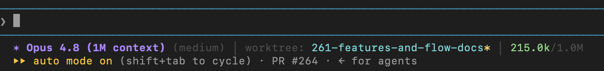

# claude-config

My personal Claude Code configuration (`~/.claude`), version-controlled.

## Statusline



## Setting up on a new machine

```bash
# 1. Clone this repo to a location of your choice
git clone git@github.com:akshadpai/claude-config.git ~/claude-config

# 2. Remove any existing config and create a symlink
rm -rf ~/.claude
ln -s ~/claude-config ~/.claude
```

## Herdr

The Herdr config lives in `herdr/` and is symlinked into place:

```bash
mkdir -p ~/.config/herdr
ln -sf ~/claude-config/herdr/config.toml ~/.config/herdr/config.toml
```

### Auto-named tabs

`herdr/auto-name.py` names a Herdr tab after what its panes are working on, using Claude Haiku. It only renames tabs still showing Herdr's default number, or a name it set itself. Turn it off with `tabs = false` in `herdr/auto-name.toml`. Its records and error log are in `~/.local/state/herdr-auto-name/`. It runs as a `Stop` hook, which lives in the untracked `settings.json`:

```json
"Stop": [
  {
    "hooks": [
      {
        "type": "command",
        "command": "f=\"$HOME/.claude/herdr/auto-name.py\"; [ -x \"$f\" ] && \"$f\"; exit 0",
        "timeout": 10
      }
    ]
  }
]
```
